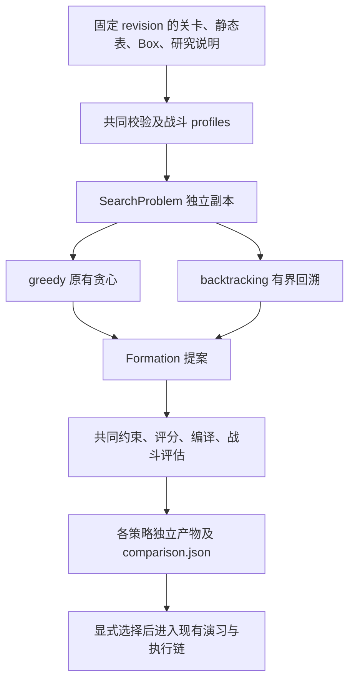

# 可替换求解策略与机制模型

[文档索引](../README.md) · [活动关求解](event-solver.md) · [战斗评估](combat-model.md)

本专题区分已经实现的策略重构，以及敌人机制模型后续需要补齐的架构。
离线候选与评分始终不代表通关；设备执行和证明仍由现有 Copilot 链负责。

## 已实现：共享问题、独立策略、共同验收

| 模块 | 责任 |
|---|---|
| `battle_generator.py` | 一次准备 profiles；将 Formation 转为计划，统一编译及战斗评估；保留旧 `generate_plan` 入口 |
| `battle_search.py` | 领域结构、末段防守候选构造、共同部署/治疗/阻挡约束和策略无关评分 |
| `battle_strategies.py` | `Strategy.solve(problem, budget) -> SearchResult`、确定性预算与显式策略表 |
| `battle_portfolio.py` | 串行/进程并行搜索、失败隔离、共同验收、去重标记和排名 |
| `battle_cli.py` | 输入快照、命令参数、Git 与来源证据、私有文件写入 |

`SearchProblem` 只携带派生 profiles、地图、路线、启用出怪、敌人适配与限制，
不携带账号元数据、完整原始 Box、网络 client 或设备句柄。策略得到独立副本，不能修改其他策略的输入。
`Formation` 通过 profile 索引引用共同模型，表达部署位置、朝向和角色；练度与技能来自共同 profiles。
这版接口面向静态末段防守，尚不表达撤退重部署、道具或控制链排程。
需要这些能力时应升级提案契约及共同验收，不能用任意动作绕过校验。

当前使用两种经审查的内置策略及显式小表，不加载动态插件或配置代码：

- `greedy` 保留原有位置、治疗网络和部署顺序启发式，尝试一个候选，仍是 `generate` 默认策略。
- `backtracking` 回访每步排名靠前的部署/治疗网络选择，按偏离贪心路径的程度确定性展开。
  后续约束失败时保留已访问分支，能回退之前的局部选择。用共同目标选择最佳可行候选。
  预算耗尽时可返回已找到的最佳候选；一个都没有则失败，不声称已证明无解。

新增算法实现 `Strategy`、加入显式表并提供行为测试，复用共同准备和验收。
不要求新算法使用 `terminal_formation`，输出仍须满足这版末段防守的共同约束。
现有两种策略共用候选构造，只改变搜索方式；更换策略不会增加敌人机制覆盖。

## 预算、并行和比较语义

`max_candidates` 为每策略最多尝试的构造次数，失败的部分构造也占一次，范围 1–64；
`branch_width` 为每决策保留的排名候选数，范围 2–8。贪心实际只使用一次构造。
这些是确定性工作量上限，不是墙钟超时，也不限制一次构造中枚举地图和医疗组合的总耗时。
地图或 Box 很大时仍可能慢；出现实际成本依据后再引入共享候选缓存或单步枚举预算。

`compare --workers 2` 默认在至多两个进程中搜索，`--workers 1` 串行；范围 1–8，
实际进程上限不超过策略数。显式采用 `spawn`，避免继承宿主已有句柄与锁；worker 只搜索，
父进程准备来源、编译评估及写产物。进程与序列化要求见
[Python ProcessPoolExecutor 文档](https://docs.python.org/3/library/concurrent.futures.html#processpoolexecutor)。
并行仅涉及离线搜索，设备执行仍遵守原有锁与预算。

共同评分 `objective_version=2` 依次比较：最弱路线接触伤害启发分、所有路线之和、主情景控制接触分、较低总部署费用。
控制分由主情景移动延缓等效时长除以情景时长，再按出怪和覆盖加权；条件控制情景不计入。
各路线按出怪数量加权，综合有限生命击杀与持续接触回转估计，再乘常态及技能覆盖；
技能覆盖系数沿用现有构造的 0.35。并列时使用稳定策略 ID 排序。
它不模拟队伍共享目标、实际接触时间或存活，不是伤害单位、通关概率或风险证明。
策略不能用自报分数修改最终排名。

每个策略保留模型版本、搜索次数与停止原因、graph/研究哈希、地图/敌人/干员 unknown；
CLI 共同证据绑定原始输入字节、静态来源、Git HEAD/dirty 及完整参数。
`comparison.json` 保留每策略失败原因、共同指标、搜索/评估耗时、候选位置与排名。
相同 Copilot 哈希只标记 `duplicate_of`，两份证据和文件均保留。
搜索耗时不包含共同准备和父进程评估，也不保证并行一定更快。

单策略失败不删除其他候选；全部搜索失败仍保存报告并返回非零。
共同输入中已明确拒绝的未知约束或不合法数据在搜索前停止，不能通过换策略或研究确认获得支持。
候选仍为 `proof_status=unproven`，比较命令不会自动执行排名第一的作业。

兼容性：旧 `generate` 默认、计划/Copilot schema 与目录布局保持；generation 的
`generator_version` 为 4，增加策略、预算、共同指标和覆盖信息；战斗模型版本 6 增加侵蚀与控制状态。不重写旧产物。
新增策略必须进入经审查的内置表；未知 ID 与重复策略拒绝。

## 后续设计：敌人机制进入共同世界模型

完整世界模型尚未实现。共同 `TargetEffects` 已接入侵蚀、控制及延迟伤害，见[战斗评估](combat-model.md)。
当前 `enemy_behavior` 覆盖少量叠层、减伤、复活与双形态，
`duel` 仍主要模拟持续接触的单目标情景。继续增加 ID 分支无法表达
敌人吸收场景对象、场景对象改变干员技力、力场改变后续敌人的完整因果链。

建议逐步形成 **来源适配 → 机制描述 → 确定性事件内核 → 情景评估 → 求解策略**：

1. **来源适配负责事实与身份。** 固定 revision 读取属性、黑板、关卡覆盖、环境和准确变体；
   将已研究语义映射为带来源的机制描述。数字不等于规则，字段名或技能描述不能自动变成行为。
   新 ID、环境、必需字段或参数语义变化须重新验证适用范围；无关附加字段可保留原值。
2. **机制由少量已验证构件组合。** 属性修正、状态/叠层、护盾、免疫、周期触发、范围选择、
   资源转移、召唤与形态转换各有窄接口。参数变化进入数据，同类机制复用构件；
   真正新规则新增小型 Python 实现和测试，先不建设任意 DSL 或通用脚本解释器。
3. **内核拥有状态及事件顺序。** WorldState 包含敌我单位、位置、HP/SP、状态、场景对象、
   出怪门控和全局资源。内核统一执行攻击开始、命中、伤害包、受击后、濒死/替代死亡、真正退场、
   形态转换及范围进出。机制读取快照并产生受检效果命令，不直接随意修改其他模块状态。
   同刻按显式阶段与稳定序号执行；区分重生和真正死亡，旧形态延迟事件按身份/代次失效。
   设置单时刻事件及召唤上限，诊断触发循环。
4. **单位和场景共享协议。** 沉默、眩晕、无敌、不可阻挡、索敌优先级及可被治疗性
   是明确能力，不散落在各技能分支。活动环境也是机制参与者，负责基质生成/吸收和力场变化；
   干员和敌人看到同一世界状态，避免双重结算。
5. **评估逐步提高分辨率。** 先用便宜的伤害/覆盖情景筛选，再对少数候选运行已支持机制下的
   全队事件模拟。索敌、路径、费用/波次、治疗分配补齐前不能称为全图模拟。
   可证实的保守界限或明确情景可用于排序；有交互时不能假定逐项最坏参数的组合仍是最坏情况。
   未知时序继续显示未知，不能从攻击间隔浮点估计宣称游戏帧级精度。

例如净手盆可组合“受击计数→增加基质→层数修正减伤→超载状态转换”，
环境再接入基质吸收事件；每段伤害通过同一结算管线。
类似敌人主要改变参数和构件组合；新的吸收/重生语义有明确代码维护位置。
不承诺未来所有机制仅靠数据即可覆盖。

能力报告最终应细化到准确实体、机制、模型情景及来源，区分已模拟、带条件估计、
未支持及经过证明不相关，附受影响输出及拒绝原因。
研究确认只能增加证据，不能把 unknown 改成已模拟；影响无法界定时停止受影响求解。
目前 `coverage` 只是原有 unknown 的结构化汇总，没有自动证明机制不相关的能力。

## 实施顺序与验证

本轮已完成策略接口、两种算法、共同验收及进程比较。下一步先提取现有净手盆和复活规则，
用相同输入对照旧 `duel` 的逐段结果；再加入“基质—敌人—干员—力场”小规模交互，
最后接入完整移动、索敌、费用与波次排程。新增能力由测试和真实证据分别验收。

离线策略验收覆盖贪心死路的约束反例、回溯恢复和预算耗尽、共同约束拒绝、未知机制、
单策略异常隔离、去重、串行/真实 spawn 一致性及公开 shell 入口的合成静态表端到端生成。
机制内核后续还需多段攻击跨重生、同时致死与治疗、状态过期与命中同刻、失效延迟事件、
条件出怪、控制免疫和未知机制影响范围测试。合成回放不等于实机通关。
